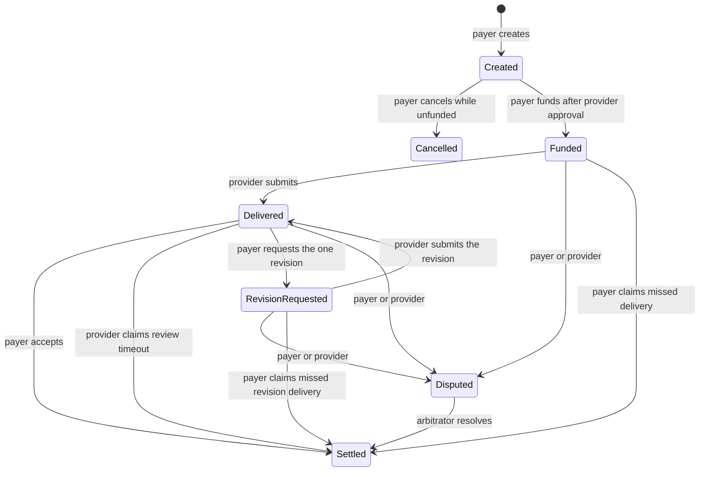

# Architecture

EvidenceBound Escrow is a research prototype for one milestone payment. A payer, a provider, and a pre-agreed arbitrator share one escrow. The contract holds mock tokens and enforces the workflow. It does not judge whether the work is good.

Full agreement text and evidence files stay off-chain. The chain stores a hash of the agreement and a commitment to each delivery.

## Repository

```text
apps/web/                         Local Next.js escrow UI through review, dispute, and withdrawal.
packages/contracts/               Solidity, Foundry tests, deploy, local demo.
packages/evidence/                Canonical manifests, hashes, and Merkle helpers.
packages/shared/                  Types and constants shared by the web app and evidence library.
experiments/                      Reserved for measurement. No result files yet.
docs/                             Protocol, threat model, evidence format, plan, baseline audit.
```

`packages/contracts` is a pnpm workspace package because it generates Merkle fixtures with `@openzeppelin/merkle-tree`. The contracts themselves compile with Foundry.

## On-chain components

```text
MockUSDC
  ERC-20, 6 decimals, owner-only mint.
  Used only as the escrow's configured token.

EscrowBase
  Roles, state machine, deadlines, funding, revision, dispute,
  settlement math, and pull withdrawals.

IndividualHashEscrow
  Stores every leaf hash for a delivery version.

ManifestHashEscrow
  Stores one keccak256 of the canonical manifest for a delivery version.
  It does not store leaves and it does not check Merkle proofs.

MerkleRootEscrow
  Stores one standard Merkle root and a provider-declared item count.
```

The three escrow contracts use the same compiler settings in `packages/contracts/foundry.toml`: Solidity 0.8.38, optimizer on, 200 runs, `via_ir` off, Cancun. A gas comparison is not valid if those settings diverge. The strategy is the deployed contract. The agreement hash binds `escrowContract` and does not carry a separate strategy field.

## Off-chain components

Phase 1 has two off-chain tools:

- `script/generate-merkle-fixtures.mjs` builds vectors with OpenZeppelin's JavaScript Merkle tree and writes both JSON and a Solidity fixture.
- `script/local-demo.sh` deploys to local Anvil and runs one acceptance on each variant.

Phase 2 adds canonical JSON, file hashing, and the export package. Phase 3 adds the Next.js app, SQLite metadata, and local file storage. The chain remains the source of escrow state and balances. The database does not authorize payment.

## State machine

Provider approval is a flag on `Created`, not a separate state. Funding requires that flag. One revision is a constant, not a parameter.



`Settled` means claimable balances are recorded. Recipients withdraw separately. A failed withdrawal does not remove the other recipient's balance.

## Evidence path

Both variants hash a leaf with the same ABI encoding:

```text
keccak256(bytes.concat(keccak256(abi.encode(schema, chain, contract, escrow, version, index, type, content, salt))))
```

That is the OpenZeppelin standard leaf. The JavaScript library sorts leaves and hashes sorted pairs. `MerkleRootEscrow` checks proofs with OpenZeppelin `MerkleProof.verifyCalldata`, which uses the same commutative Keccak.

The individual-hash contract stores those leaf hashes in order. The Merkle contract stores the root. Verification reads the stored commitment. A caller cannot pass a different root and have it treated as the delivery.

Acceptance does not call verification. The payer can pay without a proof. Verification is a separate view so an independent checker can show valid, wrong binding, or non-membership without moving funds.

## Trust boundary

| Source | Authoritative for |
| --- | --- |
| Escrow contract | State, deadlines, locked and claimable balances, delivery commitments |
| MockUSDC | Token balances of the configured mock token |
| Wallet | Who approved an agreement, funded, delivered, or settled |
| Off-chain files | Artifact bytes, salts, proofs, and the human-readable agreement |
| Future web server | Upload storage and display. Not payment authorization |

There is no administrator on the escrow. The mock token owner can mint more test tokens. That owner cannot seize a deposit through the escrow.
